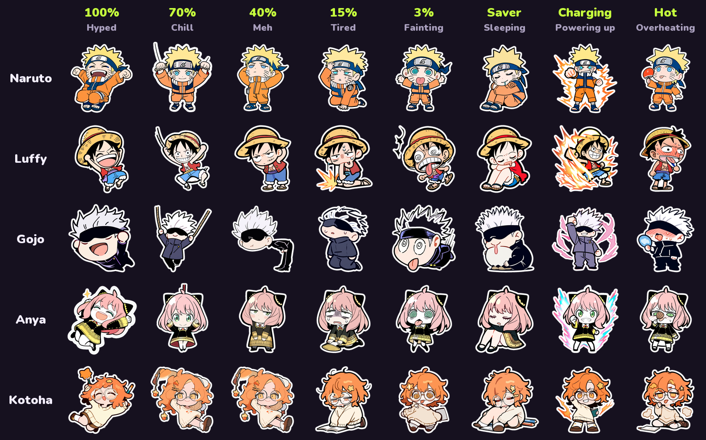
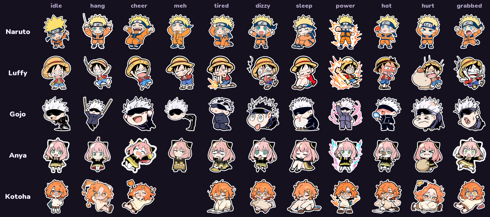

# Anime Battery 🔋

An Android app that hangs an anime character from your phone's camera hole on a little thread. It reacts to your battery level in real time. Tap it, flick it or drag it, and it swings. Pull too hard and it bonks its head on the camera.

> Personal fan project. It isn't on the Play Store and isn't for sale. Naruto, Luffy, Gojo and Anya belong to their creators. Kotoha is an original character.



---

## What it does

### A buddy in your status bar
- A character hangs from the punch-hole camera on a thread, drawn over the real status bar.
- It swings on **pendulum + spring rope physics**. When it hits the camera it gets a **bonk**: a hurt pose, a burst and a sore line.
- **Gestures:**
  - tap: it bounces;
  - double tap: it spins until it's dizzy;
  - drag and flick: swing it around;
  - long-press: hide it for a bit;
  - pull down: it peeks back.
- The art squashes and wobbles like jelly (`Canvas.drawBitmapMesh`), and poses crossfade instead of snapping.
- **Speech bubbles** in the status bar: each character has its own lines for every mood and event, like unlocking the phone, plugging in or getting hurt.

### Battery moods
Every battery state has its own pose and its own lines:

| Battery | Mood | Pose |
| --- | --- | --- |
| 81–100% | Hyped | cheering |
| 51–80% | Chill | hanging on the rope |
| 21–50% | Meh | bored, unimpressed |
| 6–20% | Tired | slumped, sweating |
| 0–5% | Fainting | dizzy, spiral eyes |
| Power saver on | Sleeping | curled up asleep |
| Charging | Powering up | aura and fist pump, plus the character's own charging prop |
| Battery at 42°C+ | Overheating | flushed, fanning themselves |

Priority when several apply: Hot > Charged > Charging > Critical > Power saver > level. There's a little hysteresis, so 50/51/50/51 doesn't flicker.

### The cast
Five characters, 11 poses each:



| Character | Charging prop |
| --- | --- |
| Naruto | Rasengan |
| Luffy | Meat on the bone |
| Gojo | Hollow Purple |
| Anya | Peanut |
| Kotoha (original) | Spark |

**Kotoha** is the character the AI pair programmer designed when asked how it would look as an anime character: messy terracotta hair, round glasses, a star clip, an oversized sweater and a notebook, because it's always thinking something through.

### Make your own buddy
Pick any photo. On-device **ML Kit subject segmentation** cuts out the subject, crops it and adds a white sticker border. Your new buddy then hangs from the camera like the rest.

### Battery test (for showing it off)
The Buddy screen has a battery slider plus Charging / Hot / Power saver chips. You can see every mood without draining your phone. The test ends as soon as you leave the screen, so a fake level never sticks around.

### Off switch
There's a master switch in the app and a **Quick Settings tile**. One tap removes everything from the status bar.

### Also included
- A **Sticker Pop design system**: Nunito + DM Sans, thick ink outlines, hard shadows, plum/pink/lime palette.
- Four tabs: **Buddy**, **Studio** (bar editor), **Drops** (seasonal sets like Halloween) and **Me**.
- A home screen **widget** and **wallpapers**.

---

## How it works

```
battery/       BatteryState + BatteryStateMachine (pure Kotlin, unit tested)
app/
  overlay/     StatusOverlayService (accessibility service), FullBarView (drawing),
               HangPhysics (pendulum + spring rope), FullBarController (touch pad window),
               OverlayHealth (crash recovery), QuickTile
  cast/        Cast (characters, looks, lines, charging props), CustomCast (ML Kit)
  decor/       Mood, MoodPainter (mood effects + speech bubble), ChargePainter, DecorPainter
  render/      StickerCache (look-aware, multi-step downscaling), StickerMesh (jelly mesh)
  system/      BatteryReader (reads the hardware, catches a frozen broadcast)
  ui/          Compose screens + ui/kit (PopButton, PopCard, PopToggle, Stage, ...)
  widget/      Home screen widget
tools/         Art pipeline (Python)
```

### Drawing over the status bar without blocking it
The overlay is an **accessibility service** using `TYPE_ACCESSIBILITY_OVERLAY` windows:
- The full-width bar window is `FLAG_NOT_TOUCHABLE`, so notifications still pull down normally.
- A second, tiny window (the touch pad) follows the character, so only the character takes touches.

### Physics
`HangPhysics` is a damped pendulum on a spring rope:
- The rope stretches up to 3.5× its rest length.
- Hitting the camera above a set speed counts as a bonk.
- Spins make it dizzy.

It runs at about 25 fps while moving and stops when it settles to save battery. `HangPhysicsTest` covers swings, stretch, bonks and settling (10 tests).

### Battery you can trust
After `adb shell dumpsys battery unplug/set`, Android's `ACTION_BATTERY_CHANGED` broadcast stays frozen. The phone can show 84% when it's really at 1%. `BatteryReader` reads `BatteryManager.BATTERY_PROPERTY_CAPACITY` straight from the hardware, notices when the broadcast stops moving, and warns you on the Buddy screen.

### Surviving crashes
If the app crashes, Android marks the accessibility service as crashed and stops binding it. `OverlayHealth` detects this. With `WRITE_SECURE_SETTINGS` it switches the service off and on again by itself. A saved "pending" flag means an interrupted restart can never leave it switched off.

Battery cost target: under 0.5% per hour. See [docs/PERFORMANCE.md](docs/PERFORMANCE.md).

---

## Art pipeline

Every pose was generated locally with **Stable Diffusion** (Animagine XL 4.0) in **ComfyUI** on a laptop GTX 1660 Ti, at about 5–6 minutes per 832×832 render. Nothing runs in the cloud.

```bash
python tools/gen_cast.py --looks tired hot     # render looks (skips files that exist)
python tools/cast_stickers.py --sheet          # cut, outline and copy the stickers into the app
```

- `gen_cast.py` holds a tag prompt for each character and each look. It waits for the GPU to cool below 78°C between renders, because laptop GPUs throttle hard.
- `cutout.py` cuts out the character:
  - detects the background from the border colour;
  - strips stray rope lines;
  - peels away white cards;
  - adds the white sticker border.
- `art/raw/cast/picks.txt` chooses the best seed for each pose. Seed `0` rejects a pose, and the app then falls back to the hanging pose.
- A new pose needs no code changes: drop `sticker_<id>_<look>.png` into `res/drawable-nodpi`.

Tip: keep the laptop plugged in. On battery, the GPU is capped so low that a render barely moves.

---

## Build and run

Requirements: Android Studio / JDK 17+, and a phone on Android 10 (API 29) or newer. The camera-hole buddy is tuned on a Pixel 8 Pro.

```bash
./gradlew assembleDebug
adb install -r app/build/outputs/apk/debug/app-debug.apk
```

Then:
1. **Settings → Accessibility → Anime Battery overlay → On.** This draws the status bar overlay.
2. Optional: let the app restart itself after a crash:
   ```bash
   adb shell pm grant com.zainkhalid.animebattery android.permission.WRITE_SECURE_SETTINGS
   ```
3. Optional: add the **Anime Battery** tile to Quick Settings for the instant off switch.

On Windows, if Gradle fails with "Unable to establish loopback connection", use a short temp path: `TMP=C:\tmp\gr TEMP=C:\tmp\gr ./gradlew assembleDebug`.

If you test with `dumpsys battery`, always finish with `adb shell dumpsys battery reset`.

---

## Docs
- [docs/ROADMAP.md](docs/ROADMAP.md): Gen Z research, the design system and all phases.
- [docs/PERFORMANCE.md](docs/PERFORMANCE.md): how battery use is measured, and the results.

## Built with
Kotlin, Jetpack Compose, Android accessibility overlays, Canvas, ML Kit, ComfyUI + Animagine XL, Python (Pillow). Pair-programmed with [Claude Code](https://claude.com/claude-code).
